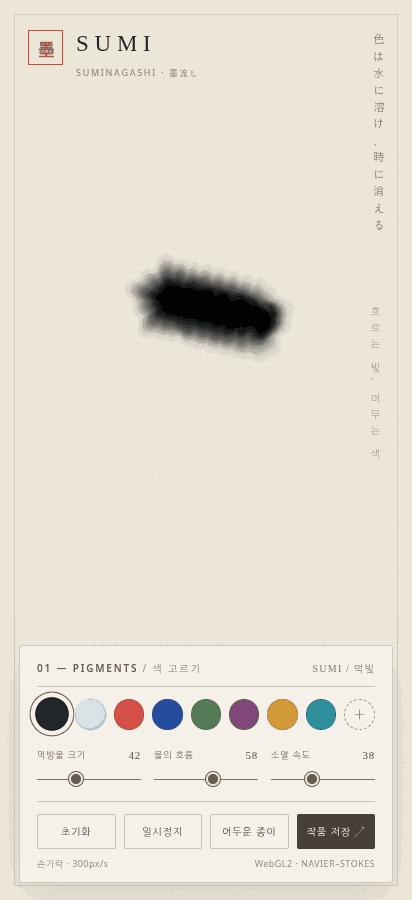

# SUMI Fluid Art — 墨流し

**Interactive Japanese-inspired ink painting · WebGL2 fluid simulation · Android APK**




`SUMI Fluid Art`는 일본 전통 먹물 흘리기 기법 **스미나가시(墨流し, Suminagashi)** 에서 영감을 받은 인터랙티브 아트 앱입니다. 손가락/마우스로 수면 위에 먹과 색을 흘리고, **물(투명)** 도구로 색을 다시 퍼뜨리거나 희석할 수 있습니다.

English: An offline-first interactive ink painting experience inspired by Suminagashi. Paint with ink, watch fluid motion settle, mix colors, and use transparent water to soften or dilute existing pigment.

## v0.3.1 — Continuous Fluid Ink

- **정지 상태의 먹 공급**: 손가락이나 S펜을 누르고 있는 동안 프레임 루프에서 약 28Hz로 먹물이 연속 공급됩니다. `pointermove`가 없어도 번집니다.
- **속도와 머무는 시간**: 이동이 느릴수록 선이 굵어지고, 접촉이 지속되면 축적 시간(wetAge)에 따라 더 두꺼워집니다. 빠르게 그리면 가늘어집니다.
- **S펜 필압**: `PointerEvent.pressure`를 유지하며 손가락은 속도 중심으로 처리합니다.
- **유체 엔진**: WebGL2 이류, 압력 프로젝션, 와도와 더불어 염료 확산 및 접촉 시 방사형 유동을 더했습니다. Canvas2D 안전 모드에도 반영했습니다.
- **자연스러운 정지**: 펜업 시 중복 운동량을 더하지 않고 기존 유속만 점성으로 서서히 감쇠합니다. 자동 배경 바람도 제거했습니다.
- **소멸 속도**: 과도했던 기본값 소멸을 완화하고, 100%에서는 빠른 소멸이 유지됩니다. 물(투명) 도구 유지.

> Galaxy Ultra S펜 실기기 및 Android GPU 동작은 기기에서 추가 검증해야 합니다. 2D 수면의 근사 시뮬레이션이며 실제 3D 수면 물리의 완전 재현은 아닙니다.

## v0.3.0 — S Pen & Momentum Patch

- **Galaxy Ultra S Pen**: WebView `PointerEvent.pointerType === "pen"` 와 실제 `pressure` 값(0~1)을 사용해 필압에 따른 먹 농도·굵기를 조절합니다. 펜 호버는 그리지 않습니다.
- **손가락 속도 반응**: 감지된 속도(px/s)를 평활화해 느리게 그리면 굵고, 빠르게 움직이면 얇아지도록 반경을 제어합니다.
- **자연스러운 흐름**: 정지 중 인위적인 회전력 및 상시 배경 가속을 제거했습니다. 손을 뗄 때 마지막 이동 운동량만 유체에 전달하고 점성 감쇠로 정지합니다.
- **물(투명)**: v0.2.6의 물 희석 기능을 유지합니다.

> S Pen 압력은 기기/Android System WebView 버전에 따라 제공 여부와 값이 달라질 수 있으므로 갤럭시 울트라 실기기 검증이 필요합니다.

## ✨ Features / 주요 기능

- **WebGL2 fragment shaders**: semi-Lagrangian advection, vorticity confinement, pressure projection (Jacobi), dye/stain layers.
- **Canvas2D fallback**: 자동 GPU 호환 모드, WebGL2 또는 float framebuffer가 없을 때 사용.
- **Pressure / speed aware**: 필압과 손가락 이동 속도에 따라 브러시 굵기·흐름 변화.
- **Colors**: 먹빛 · 주홍 · 남색 · 이끼색 · 자주색 · 금빛 · 청록 + 사용자 지정 색.
- **MIZU / 물(투명)**: 안료를 추가하지 않고 기존 색을 확산·희석하며 얼룩을 일부 약하게 만듦.
- **Adjustable flow / fade**: 물 흐름, 소멸 속도, 먹방울 크기.
- **Artwork**: 화면 초기화, 일시정지, 어두운 종이, PNG 저장.
- **Offline**: 외부 CDN, 서버 및 외부 JavaScript 라이브러리 없이 동작.

## 🚀 웹에서 실행하기

1. 저장소 루트 `index.html` 파일을 다운로드하여 Chrome/Edge/Safari 등에서 엽니다.
2. **GitHub Pages**: **Settings → Pages → Build and deployment → Deploy from a branch**에서 `main` / `/(root)`를 선택하고 Save 합니다.
3. GitHub Pages 주소: `https://<GitHub 사용자명>.github.io/SUMI-Fluid-Art/` (설정 및 배포 완료 후 접근 가능).

> `index.html` 단독 파일로 실행됩니다. 웹에서는 PNG 저장이 브라우저의 다운로드 또는 공유 기능을 사용합니다.

## 📱 APK 설치 및 Android 빌드

**준비된 APK:** [`releases/SUMI-Suminagashi-v0.3.0.apk`](releases/SUMI-Suminagashi-v0.3.0.apk) (Android 10+, 이미 서명된 패키지). 다운로드 후 기기에서 파일을 열어 설치합니다.

**Android Studio 빌드**: Android Studio에서 `android/` 디렉터리를 프로젝트로 열어 Gradle 동기화 → `app` 실행 또는 `Build APK(s)`를 실행합니다. Java 17, Android SDK 35가 필요합니다. 앱의 HTML은 저장소 루트의 `index.html`에서 **빌드할 때 자동 복사**됩니다. 에셋을 직접 중복 수정할 필요가 없습니다.

**GitHub Actions**: `Actions → Android APK build → Run workflow`로 빌드한 디버그 APK를 아티팩트로 받을 수 있습니다. `main` 브랜치에 웹/Android 코드가 변경되어도 자동 실행됩니다.

> **APK 서명 관련 중요 안내:** 동봉된 v0.3.0 APK는 이전 릴리스와 동일한 서명으로 제작된 설치용 파일입니다. **개인 서명 키는 공개 저장소에 포함하지 않았습니다.** GitHub Actions가 생성한 디버그 APK는 서명 인증서가 다르므로 기존 앱 위에 덮어쓸 수 없을 수 있습니다. 그 경우 기존 앱 제거 후 새 APK 설치가 필요합니다. 정식 배포 업데이트를 하려면 보관 중인 원래 서명 키를 안전하게 관리하고 별도 릴리스 서명 절차를 설정하세요.

## 🗂 Repository structure

```text
SUMI-Fluid-Art/
├── index.html                     # GitHub Pages + standalone web app (single source)
├── android/                       # Android Studio / Gradle project
│   ├── app/src/main/java/.../MainActivity.java
│   └── app/src/main/AndroidManifest.xml
├── releases/
│   └── SUMI-Suminagashi-v0.3.0.apk
├── .github/workflows/
│   └── android-build.yml          # Build APK on GitHub Actions
├── tests/
│   └── smoke_test.py              # Browser regression smoke test
├── scripts/
│   └── verify_package.py          # Bundle integrity check
└── docs/
    └── HANDOFF_CUMULATIVE_v0.3.0.md
```

## 🧪 Test / 테스트

```bash
python3 scripts/verify_package.py
# Optional browser regression (requires Python playwright + Chromium)
python3 -m pip install playwright pillow
python3 -m playwright install chromium
python3 tests/smoke_test.py
```

Smoke tests cover initial drawing, water selection/dilution, color changes, clearing, and responsive viewport behavior. GPU operation needs WebGL2 and `EXT_color_buffer_float`; GPU/Android physical-device compatibility is not guaranteed across devices.

## 🧩 Notes / 참고사항

- 시뮬레이션은 Navier–Stokes 기반 2D 시각 효과 **근사 모델**이며 실험실 수준의 재료 시뮬레이션은 아닙니다.
- Color blending uses pigment-density-style absorption, not a physically measured spectral mixing model.
- Project version: **v0.3.0**. Android package: `com.maxvfx.suminagashi`.
- A public open-source license has **not** been selected. Choose one separately before inviting reuse or contributions.
